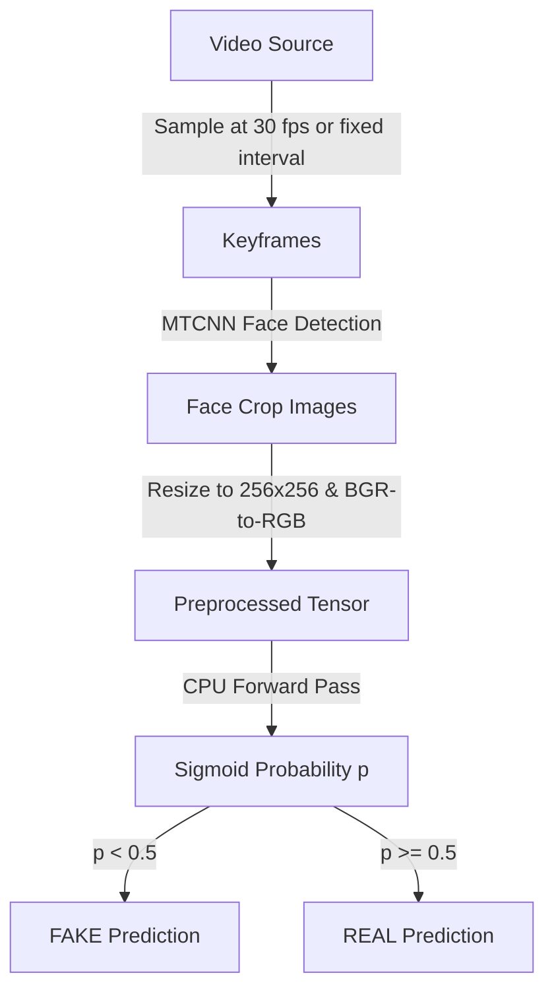

# PHASE 8 — Scientific Evaluation Plan: MesoInception-4 Validation

This document establishes the formal scientific evaluation methodology, data provenance tracking rules, leakage prevention controls, and aggregation metrics for auditing the MesoInception-4 deepfake detection model in VeriDoc.

---

## 1. Objectives
*   Measure the classification performance of the MesoInception-4 model against out-of-sample benchmarks.
*   Document generalization capability across multiple deepfake manipulation types (Deepfakes, Face2Face, FaceSwap, NeuralTextures, and advanced autoencoder pipelines).
*   Benchmark CPU inference latencies to establish performance envelopes.
*   Verify the statistical consistency of the model without tuning model architecture or weights.

---

## 2. Technical Mapping of the Production Inference Pipeline

The evaluation pipeline mirrors the verified production pipeline entry points:
1.  **Ingestion:** Incoming evidence is registered via the `POST /api/evidence/upload` endpoint, creating an entry in the `evidence` database table and storing the file in the permanent vault.
2.  **Verification:** Preprocessing computes a SHA-256 hash of the physical file and compares it to the registered database hash to verify file integrity.
3.  **Frame Sampling (Videos Only):** Videos are sampled at regular intervals (configured by `settings.VIDEO_SAMPLE_INTERVAL_SECONDS`, defaulting to 1.0s) to extract keyframes.
4.  **Face Localization:** Extracted frames (or input images) are scanned using the MTCNN face detector via `FaceDetectionService`. Bounding box coordinates and crop files are written under `storage/analysis/face_crops/` and logged in the `face_detection` database table.
5.  **Inference Preprocessing:** The face crop is loaded using OpenCV, resized to $256 \times 256$ pixels using linear interpolation, converted from BGR to RGB, scaled by `/ 255.0` to the range $[0, 1]$, and transposed to PyTorch's `(1, 3, 256, 256)` NCHW layout.
6.  **Model Inference:** `DeepfakeModelInterface.predict` executes the forward pass on CPU, returning a raw sigmoid probability $p \in [0, 1]$ representing the likelihood of authenticity (REAL).
7.  **Thresholding:**
    *   $p \ge 0.5 \implies$ **REAL**
    *   $p < 0.5 \implies$ **FAKE**
    *   $\text{Confidence} = | p - 0.5 | \times 2.0$
8.  **Database Persistence:** Predictions are stored per face in the `deepfake_prediction` table, linking back to the parent `deepfake_analysis` record.

---

## 3. Video-to-Face Evaluation Pipeline

A reproducible test runner will process video-based datasets using this sequential pipeline:

---

## 4. Dataset Provenance Tracking
To ensure full accountability and audit reproducibility, every evaluation prediction must log the following fields:

*   **`dataset_name`:** Name of the benchmark (e.g., `FaceForensics++`, `Celeb-DF v2`).
*   **`dataset_split`:** Test split partitioning tag (e.g., `train`, `val`, `test`).
*   **`source_video_id`:** Original video index or filename.
*   **`frame_number` / `timestamp`:** Frame offset within the source video.
*   **`ground_truth_label`:** Ground-truth classification (`REAL` or `FAKE`).
*   **`crop_filename`:** Relational reference to the physical cropped face image.
*   **`model_name` / `model_version`:** Running model parameters (`MesoInception-4` / `1.0`).
*   **`checkpoint_sha256`:** SHA-256 hash of the model weights file.
*   **`sigmoid_probability`:** Raw floating-point probability output.
*   **`predicted_label`:** Predicted label (`REAL` or `FAKE`).

---

## 5. Leakage Prevention Controls
*   **Source-Video-Level Separation:** Splitting the dataset by frame numbers from the same video introduces subject and background leaks. The dataset splits must be partitioned strictly by **source video ID**, ensuring no subject or video appears in both training (if fine-tuning occurred) and evaluation partitions.
*   **Official Test Splits:** For datasets like FaceForensics++, only videos belonging to the official test partition (IDs 860 to 999) will be evaluated.
*   **Deduplication:** Ensure only unique frames are evaluated per video to avoid skewed metrics.

---

## 6. Evaluation Metrics

The benchmark runner will compute:
*   **Face/Frame-Level Metrics:**
    *   **Accuracy:** Overall correct predictions ratio.
    *   **Precision:** True Fakes / Total Predicted Fakes.
    *   **Recall:** True Fakes / Total Ground Truth Fakes.
    *   **F1-Score:** Harmonic mean of Precision and Recall.
    *   **Specificity:** True Reals / Total Ground Truth Reals.
    *   **False Positive Rate (FPR):** False Fakes / Total Ground Truth Reals.
    *   **False Negative Rate (FNR):** Missed Fakes / Total Ground Truth Fakes.
    *   **ROC-AUC:** Area under the Receiver Operating Characteristic curve.
    *   **Confusion Matrix:** Count table mapping `TP`, `TN`, `FP`, `FN`.
*   **Sub-population Breakdowns:**
    *   Separate metrics per dataset (FF++ vs Celeb-DF).
    *   Separate metrics per manipulation type (Deepfakes, Face2Face, FaceSwap, NeuralTextures).
*   **CPU Performance Metrics:**
    *   Average, median, and 95th-percentile inference latency (in ms).
    *   Overall benchmark execution duration and RAM profile.

---

## 7. Face-Level vs. Video-Level Evaluation & Aggregation Review

### A. Two-Tier Evaluation
1.  **Face-Level Evaluation:** Measures raw classifier accuracy on individual face crops.
2.  **Video-Level Evaluation:** Aggregates multi-frame predictions to classify the entire video sequence as `REAL` or `FAKE`.

### B. Aggregation Rule Review
*   **Current Rule:** `any FAKE face crop -> FAKE video`.
*   **Forensic Critique:** While conservative and appropriate for static images containing single subjects, this logical **OR** combination is **not scientifically appropriate** for long video sequences:
    *   *Risk:* A video with 100 frames contains 100 face crops. If the face classifier has a false positive rate of even 1%, a completely authentic video will be misclassified as FAKE with a probability of $1 - 0.99^{100} \approx 63.4\%$.
    *   *Recommendation:* Adopt a threshold-based consensus rule for video-level evaluation (e.g., classing a video as `FAKE` if and only if more than $10\%$ of the face crops are predicted as `FAKE`, or using a probability mean of the top-k most suspicious frames).

---

## 8. Database Schema Design for Evaluation
To avoid polluting production logs, two new tables will be added to the SQLite database schema specifically for scientific evaluation runs:

### Table 1: `evaluation_run`
*   `id` (Integer, Primary Key)
*   `dataset_name` (String)
*   `dataset_split` (String)
*   `checkpoint_sha256` (String)
*   `started_at` (DateTime)
*   `completed_at` (DateTime)
*   `overall_accuracy` (Float)

### Table 2: `evaluation_prediction`
*   `id` (Integer, Primary Key)
*   `run_id` (ForeignKey to `evaluation_run.id`)
*   `source_video_id` (String)
*   `frame_number` (Integer)
*   `ground_truth` (String)
*   `predicted_label` (String)
*   `sigmoid_probability` (Float)
*   `confidence` (Float)
*   `inference_time_ms` (Float)

---

## 9. Boundary Separation
*   **Production Environment:** Restricted to registering files, checking ELA/FFT, running single/multi-face inference, writing standard custody logs, and generating reports.
*   **Research/Benchmark Environment:** Restricted to evaluating bulk dataset folders, generating scientific metric JSONs, writing results to evaluation tables, and conducting OOD latency testing.

---

## 10. Acceptance Criteria
*   **Numerical Equivalence:** PyTorch MesoInception-4 must preserve max absolute difference $< 1 \times 10^{-6}$ compared to original weights.
*   **Zero Leakage:** Test dataset contains no identities or videos from the model's training set.
*   **Reproducibility:** The benchmark command must produce deterministic results matching the saved report JSONs.
